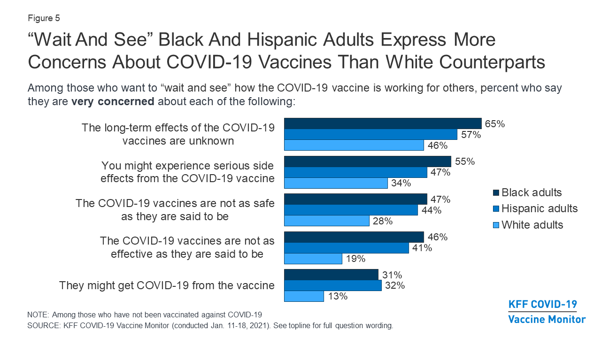
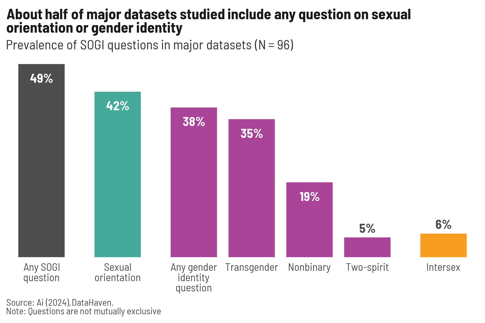

```{r}
#| label: setup
#| message: false
library(dplyr)
library(ggplot2)
library(sf)
library(forcats)

source(here::here("plotting_utils.R"))
paths_in <- list(
    cdc = "cdc_health_all_lvls_2025.csv",
    # ej = "epa_ej_index_2024.csv",
    # income = "median_hh_income_tract.csv",
    # wage = "wage_gap_race_sex_2023.csv",
    food_trend = "dcws_food_trend_state.csv",
    food_gnh = "dcws_food_demo_gnh.csv",
    food_town = "dcws_food_total_towns.csv"
) |>
    purrr::map(\(x) here::here("data", x))
```

```{r}
#| label: read-data
dfs <- purrr::map(paths_in, readr::read_csv, show_col_types = FALSE)
cdc <- dfs[["cdc"]]
# ej <- dfs[["ej"]]
food_trend <- dfs[["food_trend"]] |>
    mutate(across(c(name, category, group, group2), as_factor)) |>
    mutate(across(c(group, group2), \(x) {
        fct_relevel(x, "No kids", after = Inf)
    }))
food_gnh <- dfs[["food_gnh"]] |>
    mutate(across(c(name, category, group, group2), as_factor)) |>
    mutate(across(c(group, group2), \(x) {
        fct_relevel(x, "No kids", after = Inf)
    }))
food_towns <- dfs[["food_town"]]
```


# Data viz: what & why

## Warm-up: everyday data viz

Think through the past 24 hours. Jot down some of the data visualizations you encountered, including maps. 

- Think less technical/academic, more casual


## About me {.smaller}

* 10+ years working with public data at or with nonprofits focused on demographics, public health, community needs & assets
* Lived in 3 cities that are very different but also surprisingly similar: Chicago, New Haven, Baltimore
* Have always been very curious about how numbers can help describe & explain patterns & phenomena around me
* Very excited about useful data, nice visualizations, and good code 
* Also very skeptical & critical of data science and its applications

- Slides are online: https://camille-s.github.io/stl-data-viz
- So is the code that made them: https://github.com/camille-s/stl-data-viz


## What is data visualization?

> The representation and presentation of data to facilitate understanding

-- Andy Kirk, _Data Visualisation: A Handbook for Data Driven Design_

> Data graphics visually display measured quantities by means of the combined use of points, lines, a coordinate system, numbers, symbols, words, shading, and color

-- Edward Tufte, _The Visual Display of Quantitative Information_

## What is data visualization?

> The rendering of information in a visual format to help communicate data while also generating new patterns and knowledge through the act of visualization itself

-- Whitney Battle-Baptiste & Britt Rusert, Introduction to _W.E.B. Du Bois's Data Portraits: Visualizing Black America._


## Why _should_ you visualize data?

* Illustrate patterns
* Provide context
* Improve legibility of data
* Increase accessibility, empathy, understanding
* Gives sense of importance (positive)


## Why _shouldn't_ you visualize data?

* Can obscure patterns
* Adds abstraction & steps between reader and data
* Takes up space
* Gives sense of importance (negative)


# Questions to ask yourself {data-name="Questions"}

## Get to know your data

What's in my data? 

- _What_ is being measured? 
- _How_ is measurement defined? 
- _Where_ does it come from? 
- _Who_ or what is included / excluded?
- What's the _universe_?

## Get to know your data

Example: food insecurity

::: {.incremental}
* What is being measured? _Rate of food insecurity, 2024_
* How is measurement defined? _% of respondents who answered "Yes" to question "Have there been times in the past 12 months when you did not have enough money to buy food that you or your family needed?"_
:::

## Get to know your data

Example: food insecurity

::: {.incremental}
* Where does it come from? _2024 DataHaven Community Wellbeing Survey crosstabs_
* Who or what is included / excluded? _Breakdowns only for larger demographic groups_
* What's the universe? _Survey respondents ages 18+ in Connecticut_
:::

## Big picture questions {.smaller}

* What **background info** do I have / not have / need?
* What **story** do I want to tell / can I tell / _should_ I tell?
* What **context** will this be shown in?
* Who's the **audience**?
* Do I even need a visualization? Would a bullet point, table, or written sentence suffice?
* For maps: is the data truly about geography? Or is a map just convenient?

::: {.notes}
- default often is to make/ask for a map, but that abstracts data even further. easy to fall on the oversimplification side of the legibility balance
- might be a better way to show how something is distributed across an area, e.g. bars comparing town to region, pictogram showing all values
:::


# Data viz in the world


## Audience x purpose x venue

Successful data viz is tailored to an intended audience, an intended purpose, and a venue, and interaction between those factors

* _Who_ are you presenting to? (audience)
* _Why_ are you presenting this? (purpose)
* _Where_ will the reader encounter it? (venue)

## Audience x purpose x venue

Some examples:

::: {.table-top .table-sm}

+----------------+-----------------------+----------------------+
| Audience       | Purpose               | Venue                |
+================+=======================+======================+
| - Residents    |                       |                      |
| - Clinicians   | - Learning about data | - Print report       |
| - Researchers  | - Explaining an issue | - Online dashboard   |
| - Policymakers | - Persuading reader   | - Interactive        |
| - Skeptics     | - Advocacy            | - Social media       |
|                |                       | - Poster / billboard |
+----------------+-----------------------+----------------------+

:::

## This chart could have been a sentence

Just like many meetings could have been emails, many charts could have been bulletpoints

Each of these has a time & place

:::: {.columns}

::: {.column}

```{r}
#| label: food-gender
#| fig-width: 4 
#| fig-height: 3 
food_gnh |>
    filter(name == "Greater New Haven", category %in% c("Total", "Gender")) |>
    mutate(
        group = forcats::fct_recode(
            group,
            Total = "Greater New Haven",
            Men = "Male",
            Women = "Female"
        ) |>
            forcats::fct_relevel("Total")
    ) |>
    stylehaven::offset_lbls(value = value, fun = stylehaven::percent100) |>
    ggplot(aes(x = group, y = value)) +
    geom_col() +
    geom_text(aes(label = lbl, y = value_off), vjust = 1, size = 4) +
    stylehaven::scale_y_barcontinuous(breaks = NULL) +
    labs(
        title = "Share of adults reporting food insecurity in past 12 months, Greater New Haven, 2024",
        x = NULL,
        y = NULL
    )
```

:::

::: {.column}

<p class="lead">
**About 1 in 5** Greater New Haven adults is food insecure. **Women are more likely** than men to experience food insecurity.
</p>

:::

::::

## Audience x purpose x venue {.smaller}

You're studying local food access. Which chart would you use for a) reporting about the issue internally, b) understanding effects of policy, c) getting funding for afterschool programs? Why?

:::: {.columns}

::: {.column}

```{r}
#| label: food-audience-1
#| fig-width: 5
#| fig-height: 4
food_trend |>
    filter(category %in% c("Total", "Race/Ethnicity", "With children")) |>
    mutate(
        category = forcats::fct_recode(
            category,
            "By location" = "Total",
            "By race/ethnicity" = "Race/Ethnicity",
            "By presence of children" = "With children"
        )
    ) |>
    mutate(
        lbl = ifelse(year == max(year), as.character(group), NA_character_)
    ) |>
    ggplot(aes(x = year, y = value, color = group)) +
    geom_line(linewidth = 1.5) +
    ggrepel::geom_text_repel(
        aes(label = lbl),
        hjust = 0,
        nudge_x = 0.25,
        seed = 1,
        size = 4,
        fontface = "bold",
        family = "Source Sans 3"
    ) +
    geom_point(size = 2.5) +
    scale_color_manual(values = qual_pal) +
    scale_y_continuous(limits = c(0, NA), labels = stylehaven::percent100) +
    scale_x_continuous(
        breaks = seq(2015, 2024, by = 3),
        expand = expansion(add = c(0.5, 3))
    ) +
    theme(
        panel.grid.major.x = element_line(),
        panel.grid.major.y = element_line(),
        legend.position = "none"
    ) +
    labs(
        x = NULL,
        y = "Food insecurity rate",
        color = NULL,
        title = "Share of adults reporting food insecurity in past 12 months, Connecticut, 2015-2025"
    )
```

:::

::: {.column}

```{r}
#| label: food-audience-2
#| fig-width: 5
#| fig-height: 4
food_gnh |>
    filter(
        category %in%
            c("Total", "Race/Ethnicity", "With children")
    ) |>
    filter(name == "Greater New Haven" | category == "Total") |>
    mutate(
        category = forcats::fct_recode(
            category,
            "By location" = "Total",
            "By race/ethnicity" = "Race/Ethnicity",
            "By presence of children" = "With children"
        )
    ) |>
    ggplot(aes(
        x = value,
        y = fct_rev(group),
        fill = category == "By location"
    )) +
    geom_col(width = 0.8, alpha = 0.9) +
    scale_fill_manual(values = c("TRUE" = qual_pal[1], "FALSE" = qual_pal[4])) +
    stylehaven::scale_x_barcontinuous(labels = stylehaven::percent100) +
    facet_grid(
        rows = vars(category),
        labeller = labeller(.rows = label_wrap_gen(14)),
        scales = "free_y",
        space = "free",
        switch = "y"
    ) +
    theme(
        panel.grid.major.x = element_line(),
        panel.grid.major.y = element_blank(),
        legend.position = "none",
        strip.placement = "outside",
        strip.text.y.left = element_text(
            angle = 0,
            hjust = 0,
            vjust = 1,
            lineheight = 0.9
        )
    ) +
    guides(color = guide_legend(ncol = 3)) +
    labs(
        x = NULL,
        y = NULL,
        color = NULL,
        title = "Share of adults reporting food insecurity in past 12 months, Greater New Haven, 2024"
    )
```

:::

::::

## Audience x purpose x venue {.smaller}

These charts all show the same indicator, percent of adults without health insurance. What are some audiences & purposes that would be appropriate for each? 

```{r}
#| label: prep-tract
tract_data <- cdc |>
    filter(
        level == "tract",
        question %in% c("asthma", "no_insurance", "diabetes", "poor_sleep")
    ) |>
    select(name, indicator = question, value) |>
    tidyr::pivot_wider(id_cols = name, names_from = indicator)

gnh_sf <- cwi::tract_sf |>
    left_join(
        cwi::xwalk |> distinct(tract, tract_cog, town),
        by = c("name" = "tract")
    ) |>
    filter(town %in% cwi::regions[["Greater New Haven"]]) |>
    select(-name) |>
    rename(name = tract_cog) |>
    left_join(tract_data, by = "name")
```

:::: {.columns}

::: {.column}

```{r}
#| label: insurance-hist
#| fig-width: 5.5
ggplot(gnh_sf, aes(x = no_insurance)) +
    geom_histogram(color = "white", bins = 25) +
    stylehaven::scale_y_barcontinuous() +
    scale_x_continuous(
        labels = stylehaven::percent100,
        breaks = seq(0, 0.5, by = 0.05)
    ) +
    theme(panel.grid.major.y = element_line()) +
    labs(
        x = "Uninsured rate",
        y = "Count of tracts",
        title = "Share of adults with no health insurance, Greater New Haven census tracts, 2023"
    )
```


:::

::: {.column}

```{r}
#| label: insurance-map
#| fig-width: 5.5
#| fig-height: 2.75
ggplot(gnh_sf) +
    geom_sf(aes(fill = no_insurance), color = "white", linewidth = 0) +
    geom_sf(
        data = ~ group_by(., town) |> summarise(),
        fill = NA,
        color = "gray20",
        linewidth = 0.2
    ) +
    scale_fill_distiller(
        palette = "YlGnBu",
        direction = 1,
        breaks = seq(0, 0.5, by = 0.05),
        labels = stylehaven::percent100
    ) +
    coord_sf(ndiscr = 0) +
    labs(
        fill = "Uninsured rate",
        title = "Share of adults with no health insurance, Greater New Haven census tracts, 2023"
    )
```

```{r}
#| label: insurance-bars
#| fig-width: 5.5
#| fig-height: 2.5
cdc |>
    filter(
        name %in%
            c(
                "Connecticut",
                "Greater New Haven",
                "New Haven",
                "West Haven",
                "Hamden",
                "East Haven",
                "Milford"
            )
    ) |>
    filter(question == "no_insurance") |>
    mutate(name = as_factor(name)) |>
    stylehaven::offset_lbls(value = value, fun = stylehaven::percent100) |>
    ggplot(aes(x = name, y = value)) +
    geom_col(width = 0.8) +
    geom_text(aes(label = lbl, y = value_off, vjust = just), size = 4.5) +
    scale_x_discrete(labels = scales::label_wrap(12)) +
    stylehaven::scale_y_barcontinuous(breaks = NULL) +
    theme(axis.text.x.bottom = element_text(lineheight = 0.8)) +
    labs(
        x = NULL,
        y = NULL,
        title = "Share of adults with no health insurance by location, 2023"
    )
```

:::

::::

# Strategies

## Strategies: your audience

- *User profiling:* structured way of planning out each of your users, what they want, what they need, how they access your work, etc 
- *Scaffolding & targeting*
    - Multiple versions of same product
    - Provide guidance, onramps
- *Plain language:* is this legible at 6th grade reading level?
- *Building data literacy:* better literacy makes our work easier 

## Strategies: communication

Be able to explain *unit* & *universe*

* What is each thing that is being measured? _(unit)_
* What are all the things that could be included? _(universe)_

You can visualize it better if you can explain it

## Strategies: universes

Examples:

- _Birth outcomes:_ for some measures, unit might be babies; for others, parent giving birth
- _Survey respondents:_ is a survey given to the population at large, or just adults?
- _Households:_ is this rate the share of households, or the share of heads of households, or the share of households by some characteristic of the heads of households, or the share of the population by some characteristic of the households they live in?


# Ethical data viz

## Responsibility

* Visualizing data is a great way to deceive people (data can't be wrong...right?)
* Sometimes deception done on purpose, but I'd guess most often unintentional
* You're making a series of decisions, even in deciding to fall back on software defaults (don't)
* Some health datasets have disappeared---how do you respond?

::: {.fragment}
Important (and difficult) to strike a balance
:::

::: {.notes}
- all about balancing trade-offs: viz adds several layers & steps of reading and perceiving between reader & data, so make sure it's worth that work
:::

## Leaving things out 

Is more data always better? Should you always visualize all the data you have?

:::: {.columns}

::: {.column width=50%}

* Uncertainty: don't oversell what you know
* Avoid stigma
* Don't give credence to misinfo

:::

::: {.column width=50%}

:::

::::

## Social context {.smaller}

:::: {.columns}

::: {.column}

Your data and your work exist in a larger social context. Ask:

- Do you really need to know that demographic detail, piece of personal history, etc? 
- Should you make it public?
- How could your work be misinterpreted or weaponized?

:::

::: {.column}

:::

::::

## Generating knowledge

* By analyzing data, you're _assembling facts_
* By visualizing it, you're _framing information_ to be interpreted


# Thank you!
